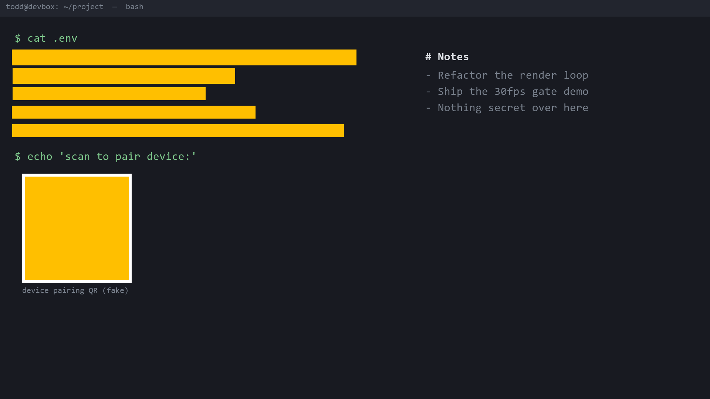

# Censr — real-time on-screen redaction for OBS (Windows)

Censr is an [OBS Studio](https://obsproject.com/) video-filter plugin that covers
sensitive on-screen content — API keys, passwords, emails, and QR codes — with an
**opaque** fill in real time, so streamers don't leak secrets on camera.

It's the Windows beachhead for an existing macOS app: this plugin reuses the
redaction logic and lets OBS handle capture, encode, streaming, and virtual-cam.

> **Opaque fills only — never blur or pixelate.** Blur/pixelation can be reversed;
> the whole security model is opaque-cover-first.

## Status — Milestone 1 gate: **met**

On a 1080p OBS source, add the **Censr Redaction** filter to any source and:

- API keys (`sk-…`, `ghp_…`, `AKIA…`, high-entropy tokens), `password/secret/token=…`
  lines, emails, and QR codes are covered with an opaque amber fill;
- innocuous text is left visible (no false positives on prose);
- first covers land **~160 ms** after content appears (< 500 ms target);
- OBS holds a steady **30 fps** with 0 dropped frames.



## Architecture — a two-rate pipeline

- **Every frame (render thread, cheap):** draw opaque amber rectangles over the
  current *cover set* using OBS's graphics API, with blending disabled so covers
  truly overwrite the pixels underneath.
- **~5 Hz (async worker thread):** render the source into a texrender, stage it to
  CPU, then run OCR + secret-regex + QR detection to update the cover set. Each
  cover has a time-to-live so it persists a beat and doesn't flicker.

Components (`src/`):

| File | Role |
|------|------|
| `censr-filter.cpp` | OBS filter: per-frame cover draw, GPU readback, cover set + TTL |
| `censr_detector.*` | Async detection worker (latest-frame-wins) |
| `ocr_engine.h` | `ICensrOcr` interface — swap point for a future GPU OCR engine |
| `ocr_winrt.cpp` | OCR via `Windows.Media.Ocr` (C++/WinRT, no bundled model) |
| `secret_rules.*` | Data-driven secret patterns (keys, labels, emails, entropy) |
| `qr_zxing.cpp` | QR / barcode detection via [ZXing-cpp](https://github.com/zxing-cpp/zxing-cpp) |

## Building (Windows)

**Prerequisites:** Visual Studio 2022 with the *Desktop development with C++*
workload (brings MSVC + the Windows SDK, which supplies the C++/WinRT headers),
CMake ≥ 3.28, and OBS Studio (to load/test). ZXing-cpp is fetched automatically by
CMake.

The template's Windows preset pins the SDK to `10.0.22621`. If you have a different
SDK, add a `CMakeUserPresets.json` (git-ignored) that retargets it:

```json
{
  "version": 8,
  "configurePresets": [
    { "name": "windows-x64-local", "inherits": ["windows-x64"],
      "architecture": "x64,version=10.0.26100" }
  ],
  "buildPresets": [
    { "name": "windows-x64-local", "configurePreset": "windows-x64-local",
      "configuration": "RelWithDebInfo" }
  ]
}
```

```bash
cmake --preset windows-x64-local      # downloads OBS deps + ZXing, configures
cmake --build --preset windows-x64-local
```

**Deploy** to the per-user OBS plugin folder (no admin needed):

```
%ProgramData%\obs-studio\plugins\censr\bin\64bit\censr.dll
%ProgramData%\obs-studio\plugins\censr\data\...
```

## Verification harness

`tools/` contains a Python harness that drives OBS via its WebSocket server to
build a test scene, apply the filter, capture screenshots, and report fps — so
detection and the fps gate can be checked automatically. See `tools/obs_verify.py`
and `tools/make_fixture.py` (generates a 1080p fixture with **fake** secrets).

## Roadmap

- **Step 3 (zero-leak):** a 1–2 s frame-delay buffer so a frame is only shown after
  its detection has finished.
- **GPU OCR:** swap `ICensrOcr` for a PaddleOCR/ONNX engine on the GPU for much
  higher accuracy on dense/random tokens than `Windows.Media.Ocr`.
- Rounded-corner covers; per-word (vs per-line) redaction granularity.

## License

GPL-2.0-or-later (OBS plugins link libobs, which is GPL). See [LICENSE](LICENSE).
